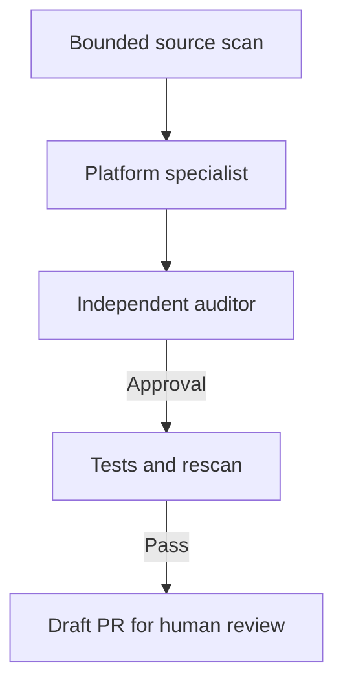

# Architecture and trust boundaries

Charisma has two connected workflows: website observation and source maintenance. Runtime reports help a person investigate; the first version does not map a browser report directly to a source location or automatically launch a repair from untrusted telemetry.

The browser monitor sends a small, fixed event schema to the ingestion server. Exact origin checks and a public installation key limit accidental cross-site use. They do not authenticate an attacker running their own HTTP client. Treat incoming reports as untrusted, apply edge rate limits, and keep the dashboard behind private access controls.

The source workflow is:

A model sees only up to three selected existing source files. Credentials detected by the built-in patterns block sharing. These patterns are incomplete; inspect sensitive or proprietary source before enabling model requests. Repository text and findings are treated as data, not authority to add commands or expand scope.

The specialist cannot choose test commands. Tests come from the operator's CLI arguments or runner configuration. The model cannot edit test directories, GitHub workflows, migrations, package manifests or credentials files. Other source changes still need careful review: a path allowlist is not semantic proof of safety.

The auditor uses a separate request with the original and proposed source, rather than the specialist's explanation. A different review model can be selected. Both models can still make the same mistake. Verification therefore runs actual commands and scans the candidate again; approval alone never publishes a change.

A worktree isolates changes from the original working tree. **It is not an execution sandbox.** Git filters, build tools and project tests can execute code. Use trusted repositories and a disposable host or CI environment with narrowly scoped credentials. Test children receive a reduced environment, but they can still read files and use host permissions. The local receipts and hashes detect accidental drift; they are not signed, tamper-proof attestations against a hostile local user.

The background runner holds one process lock per state directory. It processes projects sequentially and records each project/commit/configuration once. A crash leaves the run recorded, preventing an automatic duplicate model request. Inspect the run before deliberately creating a retry. Polling uses committed local source; syncing a remote repository remains an operator task.

Web, iOS and Android specialists share the proposal/audit interface and have separate platform instructions. Native source support is not a native runtime SDK. iOS testing needs a Mac and Xcode; Android testing needs its SDK, JDK and relevant device/emulator setup. No toolchain is inferred or silently marked as passed.

Sources informing the checks:

* [Apple App Transport Security exceptions](https://developer.apple.com/documentation/bundleresources/information-property-list/nsapptransportsecurity/nsallowsarbitraryloads)
* [Android WebView file access](https://developer.android.com/privacy-and-security/risks/webview-unsafe-file-inclusion)
* [MDN browser error events](https://developer.mozilla.org/en-US/docs/Web/API/Window/error_event)
* [OpenAI structured outputs](https://developers.openai.com/api/docs/guides/structured-outputs)
* [Playwright accessibility testing limits](https://playwright.dev/docs/accessibility-testing)
