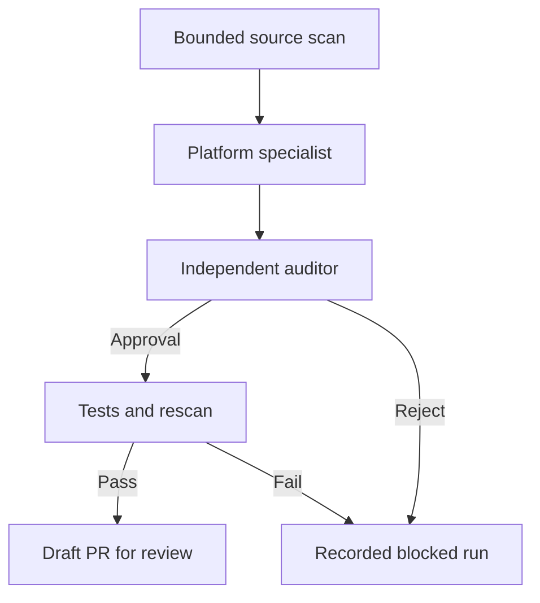

# Architecture and trust boundaries

Charisma separates observation, maintenance and protection. Browser/native reports help an operator investigate. They do not carry authority to run commands, edit source or block an address. Trusted backend signals use a separate credential and a fixed policy. Repairs use explicitly configured source checkouts and tests.

## Source maintenance

The specialist and auditor receive separate requests. The auditor sees original and proposed source without the specialist's explanation. A different model may be selected, but both can still make the same mistake. Test outcomes and human review remain necessary.

Each plan selects up to three existing files from one platform. Built-in secret patterns block sharing when detected. These patterns are incomplete; only enable model calls for source you are authorised to share. Repository text is treated as data rather than authority to expand scope. The provider request uses strict structured output, fixed endpoint/limits and no automatic retries.

The model cannot select test commands or edit protected test directories, workflows, package manifests, migrations or credential files. A path restriction is not proof of semantic safety. Original/proposed hashes and audit checks reject drift. The deterministic HTML language strategy is re-derived during validation so an arbitrary patch cannot bypass audit by claiming to be an offline language fix.

A Git worktree separates candidate changes from the original checkout. It is not an execution sandbox. With a pinned test image, commands run in Docker without network access, inherited host secrets, added capabilities or a writable root filesystem. Only the candidate is mounted writable; resource limits and a timeout apply. Timed-out containers are explicitly removed. Tests must have their dependencies prepared before execution.

Without the container option, trusted tests execute with host privileges and a reduced environment. iOS uses an explicitly isolated Mac, since Linux cannot run Xcode. Git operations, filters and other coordinator activity are outside the test container, so the worker itself must remain isolated and free of unrelated secrets. Do not mount the Docker socket into the public monitor.

Verification records command outcomes, rescans targets and rejects new built-in findings. Publishing rechecks the recorded candidate and opens only a draft PR. Local receipts are integrity checks, not signed external attestations against a malicious host administrator.

## Coordination and history

One runner holds a process lock per state directory and processes projects sequentially. It records each project/commit/configuration before external model work, so a crash does not automatically repeat spending. Remote repository synchronisation belongs to the operator. Pause is checked between phases; an in-progress request can finish. Candidate undo uses a separate cycle lock and refuses later or committed changes.

The public monitor is separate from the repair worker by default. Connecting writable worker state and candidate paths grants the monitor additional privileges. Prefer a private operator-only endpoint for worker controls.

## Runtime observation

Browser and native SDKs send small enumerated payloads to exact endpoints. Public installation identifiers and allowed origins reduce accidental misuse but do not authenticate a hostile custom HTTP client. Reports are always untrusted. The dashboard requires private bearer credentials, uses text rendering rather than HTML insertion, and keeps tokens only in tab memory.

Gunicorn runs the shared WSGI application behind TLS Caddy. The standalone `serve` command is a development server. JSON sizes, event counts and rate-limit tables are bounded. Shared SQLite rate counters work across WSGI workers. The application trusts a forwarded address only from an explicitly configured peer and only when the value is a single valid IP.

## Protection

The gateway authenticates policy requests with a separate token and supplies the service/address itself. Service policies are explicit, and automatic blocking is disabled by default. Only trusted `auth_failure` observations can meet its threshold. Runtime telemetry, ordinary server errors and model conclusions cannot trigger blocks. Operator isolation is temporary and scoped to one registered service.

Policy checks fail closed in the provided proxy. This can deny legitimate access during a monitor outage, which is an availability tradeoff to test. The gateway is not a general exploit detector or distributed denial-of-service platform.

Protection records form a local HMAC hash chain. Verification detects altered entries with the original key. Without an independently retained head/checkpoint, removal of the end of a valid chain cannot be detected. A host/key compromise can defeat local records. Preserve encrypted backups and off-host checkpoints where required.

PostgreSQL isolation is a separate, explicit restrictive-policy integration. It does not alter application tables automatically, replace existing ownership rules or prevent a privileged DBA from bypassing controls.

## Recovery and assessment

SQLite restoration requires a matching backup manifest, integrity/hash checks, an offline operator assertion and a pre-restore backup. Static release activation verifies files and atomically switches one symlink. Neither mechanism reverses every external side effect.

The ZAP CI workflow targets only its disposable monitor fixture on an internal network. It records actual scanner output and requires a reported target endpoint count. Imports validate origin scope and preserve scanner quality observations. Supplied reports are not cryptographically authenticated, and automated scanning is not a complete manual penetration test.

## Primary references

* [Apple App Transport Security exceptions](https://developer.apple.com/documentation/bundleresources/information-property-list/nsapptransportsecurity/nsallowsarbitraryloads)
* [Android WebView file access risks](https://developer.android.com/privacy-and-security/risks/webview-unsafe-file-inclusion)
* [OpenAI structured outputs](https://developers.openai.com/api/docs/guides/structured-outputs)
* [Caddy forward authentication](https://caddyserver.com/docs/caddyfile/directives/forward_auth)
* [Gunicorn settings](https://gunicorn.org/reference/settings/)
* [ZAP baseline scan](https://www.zaproxy.org/docs/docker/baseline-scan/)
